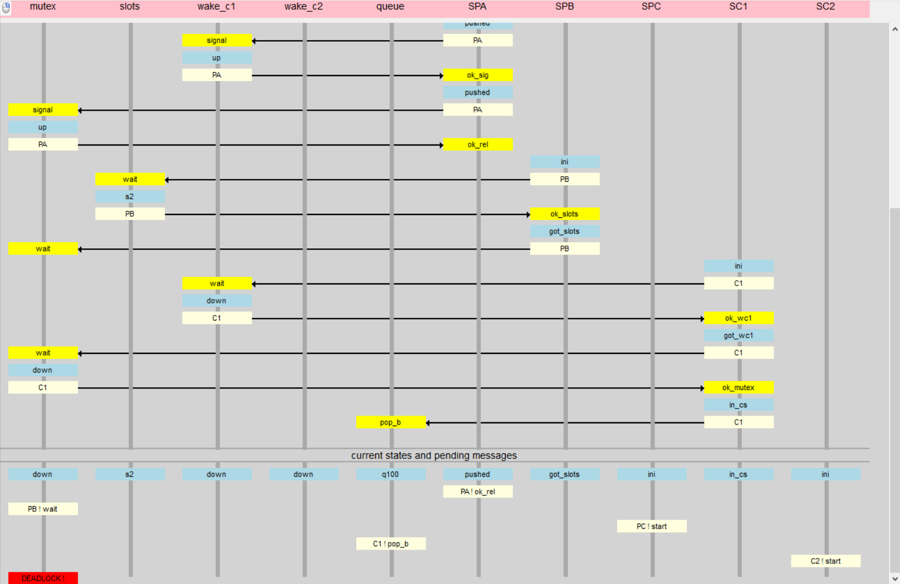

# EOPS Lab 4: Formal Verification

This project contains the formal verification of a producer-consumer synchronization mechanism using the Rybu modeling language and the DedAn verifier.

The system models three producers and two consumers operating on a shared bounded queue. The repository includes two variations of the system model:
- A correct model that proves the absence of communication deadlocks.
- A broken model that explicitly demonstrates a common deadlock resulting from a circular wait on crossed semaphores.

## Verification Result

